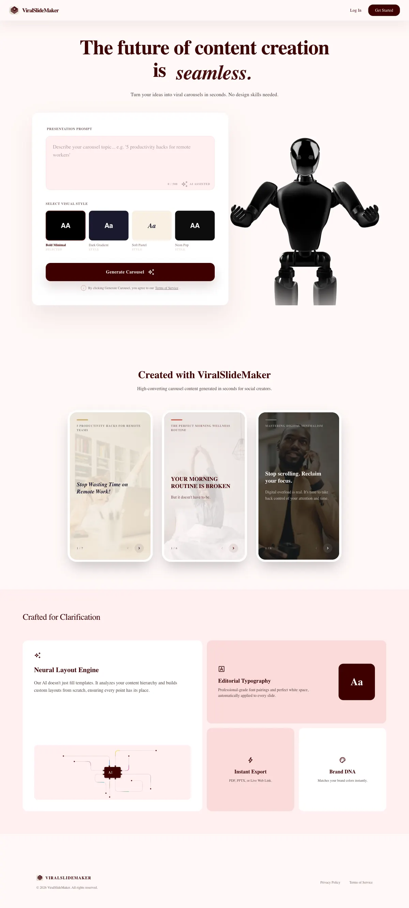

<div align="center">

# ViralSlideMaker

Type a topic, pick a style, and get a scroll-stopping carousel ready to post on Instagram and TikTok in seconds.


</div>

---

## Features

- **Prompt to carousel**: AI writes and lays out the whole deck in one of several visual styles and 15 templates
- **Real editor**: drag-and-drop slide reordering, draggable text, and built-in Pexels stock photos
- **Style from reference**: upload example posts and Gemini vision extracts a matching style
- **Export**: PDF, PPTX, or a live web link, plus a public explore feed and user profiles
- **Developer API + MCP server**: Claude, Cursor, and other agents can create, edit, and render carousels

## Stack

| Layer | Tech |
|---|---|
| Frontend | Next.js, React, Tailwind, shadcn, Spline 3D |
| Data & auth | Supabase |
| AI | Google Gemini (text, image, vision) |
| Rendering | Playwright + sharp |
| Billing & infra | Stripe, Upstash, Vercel |

## Running it

```bash
cp .env.example .env   # fill in your own keys
npm install
npm run dev
```

## Status

ViralSlideMaker was built in 2026 and is no longer live. The code is published here as a portfolio project. Read the case study at [diegofill.com/projects/viralslidemaker](https://diegofill.com/projects/viralslidemaker).

<details>
<summary>Full landing page</summary>



</details>

---

Built by [Diego Fill](https://diegofill.com).
